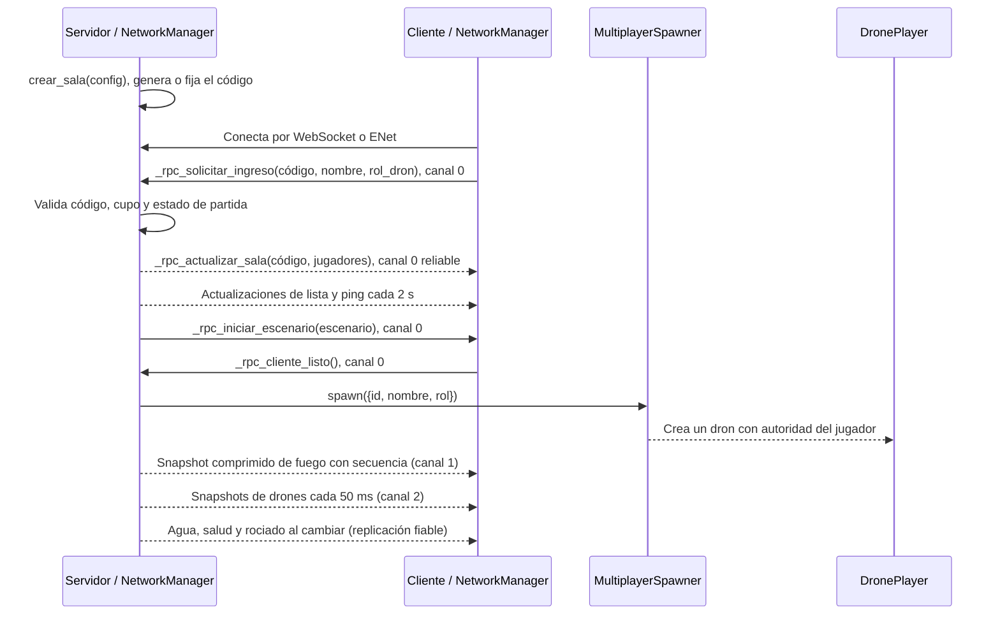

# Protocolo de red

## Transporte y canales

`NetworkManager` es el autoload dueño de la conexión y de la sala. El transporte predeterminado es WebSocket (`ws://`), compatible con clientes nativos y Web exportados. En instalaciones nativas se puede seleccionar ENet con `--transport=enet`; ENet usa UDP y no está disponible en navegador.

| Canal | Contenido | Modo |
|---|---|---|
| 0 | Ingreso, validación, código y lista de jugadores, ping, inicio de misión | Reliable |
| 1 | Deltas secuenciados y snapshots comprimidos del fuego | Reliable |
| 2 | Snapshots de posición, rotación, velocidad y apuntamiento de drones (20 Hz) | Unreliable ordered |

ENet reserva tres canales. WebSocket mantiene un flujo fiable y ordenado: Godot conserva el número lógico de canal en los RPC, pero el transporte no multiplexa canales independientes.

El servidor replica además `agua_actual`, `current_health` e `is_discharging` con `MultiplayerSynchronizer` fiable al cambiar. Las transformaciones también se replican con el sincronizador a 5 Hz como respaldo. El overlay F3 muestra una estimación de bytes/s por jugador, no una medición directa de los bytes del socket.

## Flujo de conexión



El servidor envía correcciones completas de la grilla cada 3 s. Si el cliente detecta un salto en la secuencia de deltas, solicita un snapshot inmediato; solo el servidor avanza la simulación y aplica el agua.

## Salas y validación

- El servidor genera un código numérico de cuatro cifras si `config["codigo"]` está vacío. El resto de los clientes presenta el mismo código al llamar `unirse_a_sala(direccion, puerto, codigo)`.
- `max_jugadores` debe estar entre 2 y 6 e incluye al anfitrión cuando la sala tiene anfitrión local. En servidor dedicado, todos los espacios son para clientes.
- El servidor es quien asigna rol, equipo y ping. El cliente solo solicita entrada con el código y su nombre. Sala llena, código incorrecto, nombre duplicado o partida ya iniciada producen rechazo; una desconexión puede volver a entrar con el mismo nombre.
- Cada jugador replica `rol_dron` en el diccionario de sala. El servidor valida cada cambio y limita a un solo Táctico; las salas muestran los roles ocupados. Los roles y sus valores de equilibrio se cargan desde `data/roles/*.tres`.
- Los escenarios disponibles para salas son Aguaragüe (`aguarague`) y Campo Pajoso (`campo_pajoso`); el servidor dedicado valida ambos antes de cargar la escena.
- Q solicita la habilidad especial del rol; el servidor valida autoridad y enfriamiento antes de aplicarla. El Explorador puede lanzar retardante con clic derecho; únicamente el servidor modifica la FireGrid. El pulso térmico y la marca del Táctico se notifican a los clientes correspondientes por RPC fiable.
- `iniciar_partida()` solo se acepta desde el servidor. Al cargar la misión, el servidor instancia los drones mediante `MultiplayerSpawner`; los clientes notifican que el escenario está listo antes de recibir su dron.
- WebSocket sin TLS (`ws://`) está pensado para desarrollo o redes de confianza. Para conexiones TLS, pasa el host con prefijo `wss://` y un puerto con certificado válido; el puerto se entrega por separado a `unirse_a_sala`.

## Servidor dedicado

Pasa los argumentos propios de la aplicación después de `--`; los argumentos de Godot (`--headless`, `--path`) van antes:

```text
godot --headless --path . -- --server --port=8910 --room=1234 --scenario=aguarague --max-players=6 --difficulty=media
```

Para ENet nativo:

```text
godot --headless --path . -- --server --transport=enet --port=8910 --room=1234 --scenario=aguarague --max-players=6 --difficulty=media
```

El servidor dedicado inicia en sala y espera conexiones. La lógica que gestione el lobby debe llamar `NetworkManager.iniciar_partida()` cuando corresponda.

## Prueba local manual

1. Ejecuta una instancia nativa con el comando de servidor WebSocket anterior.
2. En dos instancias cliente, abre **MULTIJUGADOR**, introduce un nombre, `127.0.0.1`, el mismo puerto y código, y pulsa **UNIRSE A SALA**.
3. La lista muestra los dos pilotos, su rol y RTT; el panel del cliente muestra el mismo código enviado por el servidor.
4. Para probar anfitrión local, crea una sala en una instancia y usa el código mostrado en las otras.

También se pueden automatizar clientes nativos/headless con argumentos de usuario:

```text
godot --headless --path . -- --connect=127.0.0.1 --port=8910 --room=1234 --name=Piloto-1
godot --headless --path . -- --connect=127.0.0.1 --port=8910 --room=1234 --name=Piloto-2
```

