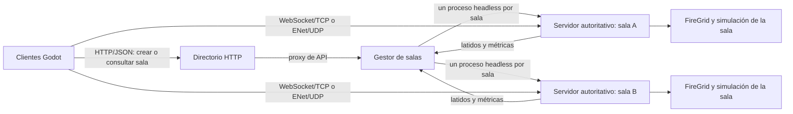

# Arquitectura de salas del juego

El directorio publica la API HTTP para crear y localizar salas. El gestor reserva
un puerto y lanza un proceso Godot `--headless` para cada partida; los clientes
se conectan directamente al servidor autoritativo de esa sala. Cada proceso
mantiene su propia instancia de `FireGrid`, valida el estado de la partida y
envía las métricas al gestor.

## Motores paralelos y motor de juego

Las versiones secuencial, OpenMP y OpenMPI de `src/` son un estudio académico de
rendimiento. OpenMP permite medir memoria compartida y OpenMPI permite analizar
descomposición y comunicación distribuida; no son dependencias del servidor del
juego.

En una partida, `FireGrid` actualiza una lista de celdas del frente de fuego en
lugar de recorrer la grilla completa en cada tick. La ejecución en procesos
independientes por sala aísla los ticks, jugadores y fallos entre partidas, y
permite asignar recursos por proceso. Por ello, MPI/OpenMP no sustituyen el
modelo de sala autoritativo: sirven para el experimento de escalabilidad,
mientras el juego usa FireGrid dentro de cada servidor de sala.

## Reproducir

- Ejecutar la sala dedicada con
  [`infrastructure/game/docker-compose.yml`](../../infrastructure/game/docker-compose.yml).
- Consultar puertos, variables y logs en
  [`README_servidor.md`](../../README_servidor.md), en la raíz del repositorio.
- Medir la simulación del motor con
  [`benchmark_fire_grid.gd`](../../scripts/tools/benchmark_fire_grid.gd) con
  `godot --headless --path . --script res://scripts/tools/benchmark_fire_grid.gd`.
- Generar las gráficas C con [`graficas.py`](./graficas.py).
